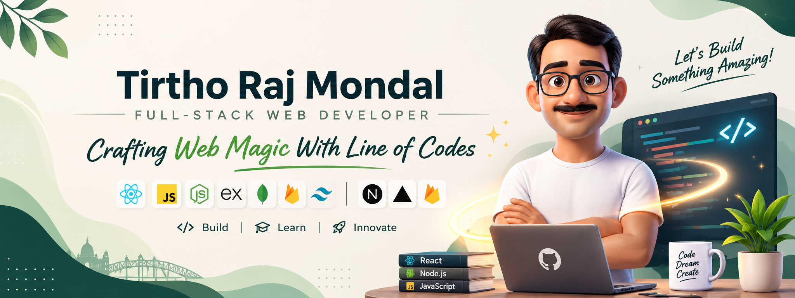

  

  

##  About Me

I'm a Full Stack Web Developer with an academic background in English Literature and a growing passion for technology.

Coming from a non-CSE background, my journey into web development began with structured online learning and gradually evolved through hands-on practice, personal projects, and continuous exploration.

I enjoy turning creative ideas into functional digital experiences and learning something new with every project I build.

- 💻 Passionate about building modern and responsive web applications.
- 🌱 Currently strengthening my skills in the MERN stack.
- 🛠️ Learning through practical projects and real-world challenges.
- 🧠 Interested in problem-solving, clean code, and continuous improvement.
- 🎯 Working towards becoming a skilled Full Stack Developer.
- ⚡ Believe that curiosity and consistency can take you beyond boundaries.

**My philosophy:** Your academic background doesn't define your technical potential. Your curiosity, effort, and willingness to learn do.

 

##  Tech Stack

### 🖥️ Languages

  

### ⚛️ Frameworks & Libraries

  

### 🗄️ Backend & Database

  

### ⚡ Tools & Platforms

  

### 🚀 Deployment & Hosting

  

 

## Github Streak  

## Connect with me  

  
  
  
  
  
  <!-- 
  
   -->
  
  <!--  -->

  
  
---

  

  Keep learning, keep building, and never stop turning ideas into reality. 🌱

  

